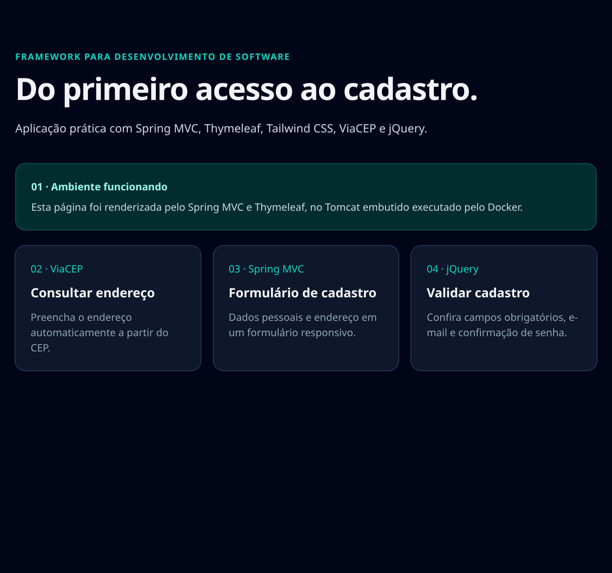
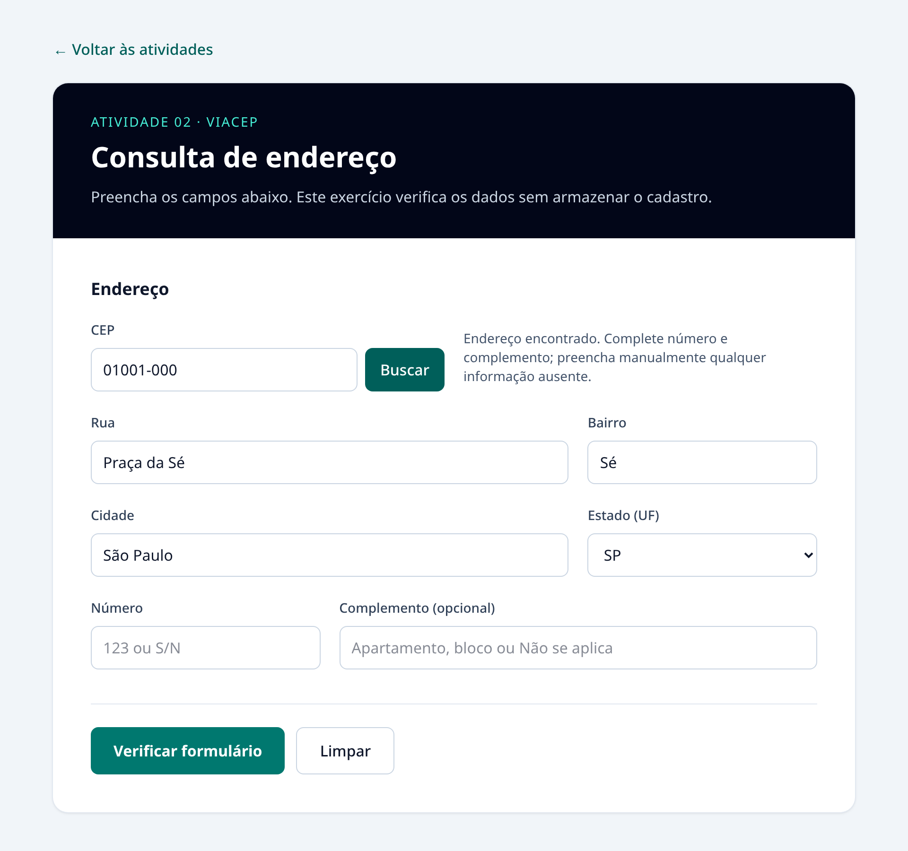
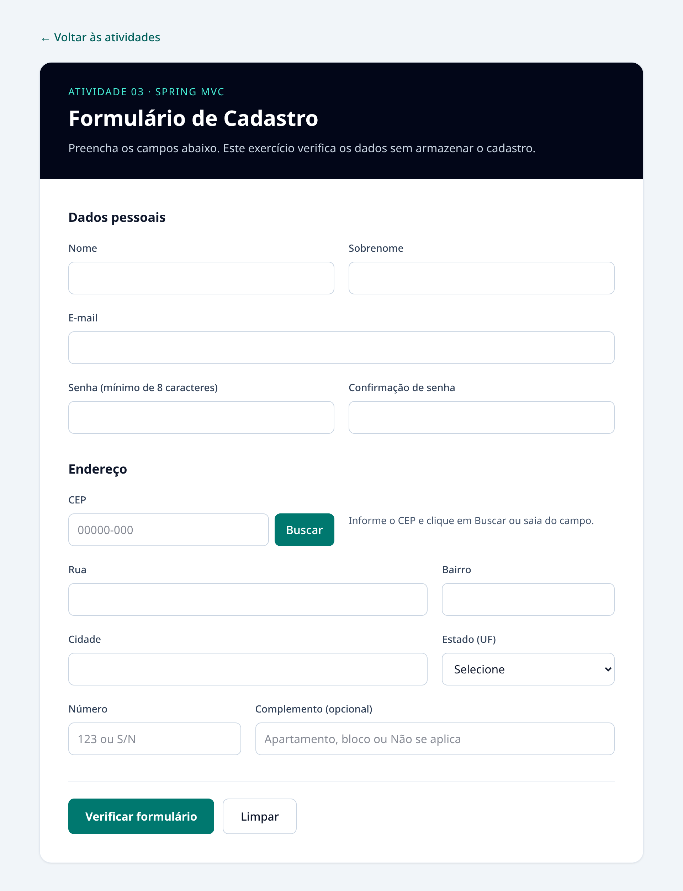
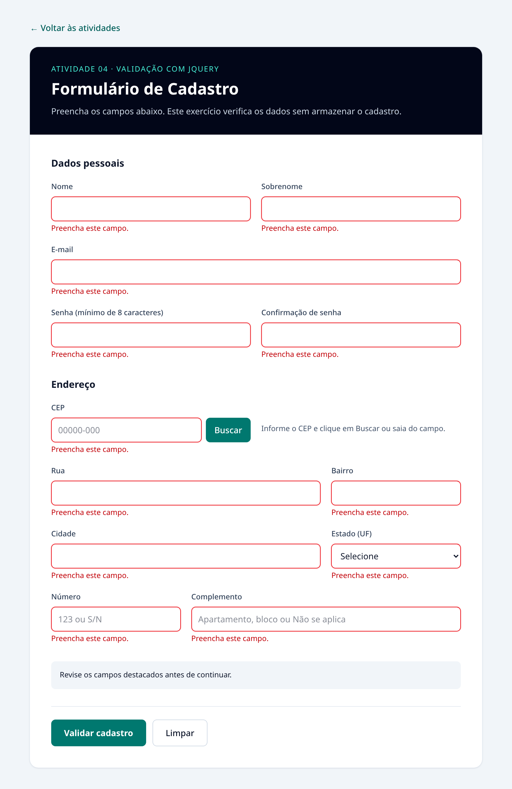
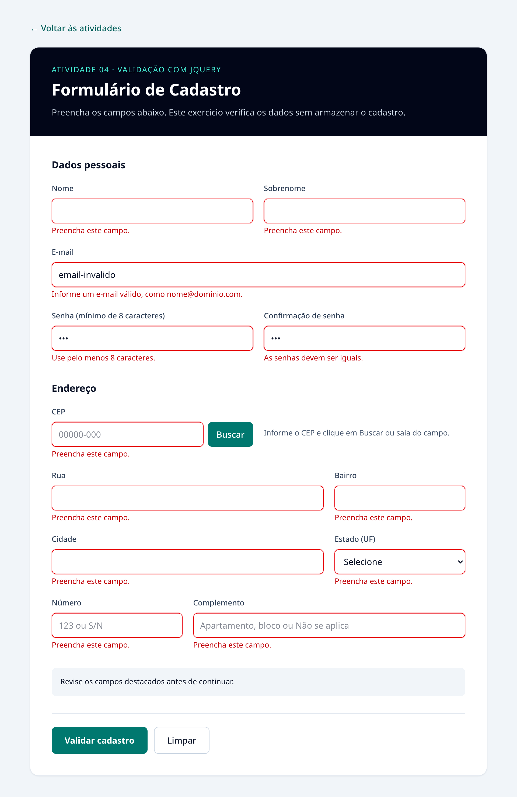
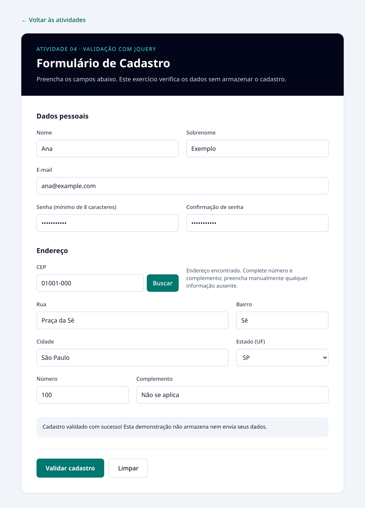
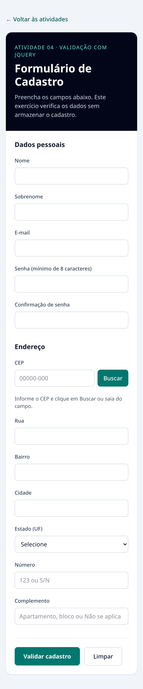

# Cadastro de usuário — atividades práticas

Aplicação Spring Boot **4.1.2**, Java **25**, Spring MVC, Thymeleaf, Tailwind CSS 4 por CDN e jQuery 3.7.1. Build e execução acontecem no Docker; não é necessário instalar Java ou Maven localmente.

## Executar

Abra esta pasta (`cadastro-usuario`) no IntelliJ. No terminal dessa pasta, copie `.env.example` para `.env`:

```sh
cp .env.example .env
```

Em seguida:

```sh
docker compose up --build
```

Acesse **http://localhost:8087**. A porta local está definida no arquivo `.env`, pois a 8080 já estava ocupada neste computador. Para executar em segundo plano, acrescente `-d`. Para encerrar:

```sh
docker compose down
```

Se a porta estiver ocupada: `APP_PORT=8081 docker compose up --build`, acessando http://localhost:8081. Após editar o código, execute novamente o comando com `--build`.

## Configuração

As configurações locais ficam no `.env`, que não é versionado. O arquivo `.env.example` fornece os valores de exemplo:

| Variável | Finalidade |
| --- | --- |
| `APP_PORT` | Porta publicada no computador para acessar a aplicação. |
| `SPRING_APPLICATION_NAME` | Nome da aplicação, encaminhado pelo Compose ao Spring. |

O Compose lê o `.env` para substituir as variáveis do `compose.yaml`. O Spring recebe o nome pelo ambiente do contêiner; não é necessário um `application.properties` para esta configuração. O Spring não lê arquivos `.env` automaticamente.

## Atividades

| Rota | Resultado |
| --- | --- |
| `/` | Atividade 1: página renderizada pelo Spring MVC, comprovando o ambiente web |
| `/endereco` | Atividade 2: formulário de endereço e consulta ao ViaCEP |
| `/cadastro` | Atividade 3: formulário responsivo com dados pessoais e endereço |
| `/cadastro-validado` | Atividade 4: consulta de CEP e validações com jQuery |

Os exemplos são organizados em rotas de uma aplicação única. O controller escolhe a apresentação Thymeleaf. `static/js/main.js` consulta a API; `static/js/validation.js` contém as validações com jQuery. Tailwind e jQuery são carregados por CDN: é necessário acesso à internet para esses recursos e para o ViaCEP.

## Exemplos da interface

### Página inicial



### Consulta de endereço

O CEP `01001-000` preenche rua, bairro, cidade e UF pela API ViaCEP.



### Formulário de cadastro



### Validações

As mensagens indicam campos obrigatórios, formato de e-mail, tamanho mínimo da senha e divergência na confirmação.





### Dados válidos

Exemplo com dados fictícios. A mensagem indica somente validação local; o cadastro não é armazenado.



<details>
<summary>Visualização em tela estreita</summary>



</details>

## Regras e testes manuais

- Digite `01001-000` e saia do campo ou clique em Buscar: rua, bairro, cidade e UF são preenchidos.
- CEP com menos de 8 dígitos exibe orientação; CEP inexistente informa que não foi encontrado.
- Falhas de rede ou timeout exibem mensagem e permitem preenchimento manual. Número e complemento são preenchidos pela pessoa.
- Na atividade 4, tente verificar vazio: campos destacados, mensagens individuais e foco no primeiro erro.
- Experimente e-mail inválido, senha inferior a 8 caracteres e confirmação diferente.
- Preencha os dados válidos e confira a mensagem de sucesso. Limpar restaura o formulário.
- Confira o layout em tela estreita e navegação por teclado.

Todos os campos da atividade 4 são obrigatórios, seguindo a leitura literal do roteiro. Caso não exista complemento, informe “Não se aplica”. Nas demais telas, complemento é opcional. A confirmação de senha completa os 12 campos mencionados no resultado da atividade 3 (o enunciado enumera apenas 11).

## Adaptações em relação ao PDF

- IntelliJ substitui NetBeans; Maven substitui Ant.
- Spring Boot 4 com Spring MVC e Tomcat embutido substitui Spring antigo e Tomcat 8 externo.
- Thymeleaf substitui JSP e redirecionamento `index.htm`.
- Tailwind por CDN substitui Bootstrap, conforme decisão do projeto.
- Dockerfile multi-stage compila, testa e empacota o JAR; Compose publica o servidor.

Essas adaptações preservam os resultados funcionais, mas precisam ser consideradas na avaliação pois o roteiro nomeia tecnologias específicas. Não há banco de dados, envio ou persistência de senhas/dados pessoais; o botão demonstra validação local.

## Verificação automatizada

`docker compose build` executa `mvn verify`, incluindo testes HTTP com servidor em porta aleatória: navegação inicial, campos por atividade, renderização Thymeleaf, inclusão condicional de jQuery, arquivos JavaScript e resposta 404.

Para executar testes isoladamente com Maven no contêiner:

```sh
docker run --rm -v "$PWD:/workspace" -w /workspace maven:3.9-eclipse-temurin-25 mvn -B verify
```

### Testes de interface no navegador

Com a aplicação iniciada e pronta para receber requisições:

```sh
docker compose up -d --build cadastro-usuario
docker compose --profile test run --build --rm testes-interface
```

Os testes em `tests/test_formularios.py` executam Chromium e verificam campos obrigatórios, foco no erro, e-mail, senhas, dados válidos, limpeza, consulta de CEP, CEP incompleto/inexistente, falha de rede e layout estreito. As respostas do ViaCEP são controladas para tornar os cenários reproduzíveis; a integração real pode ser conferida manualmente. O carregamento de jQuery e Tailwind por CDN requer internet.

Referências: [Spring](https://spring.io/projects/spring-boot), [Tailwind](https://tailwindcss.com/docs/installation/play-cdn), [ViaCEP](https://viacep.com.br/), [jQuery](https://jquery.com/).
